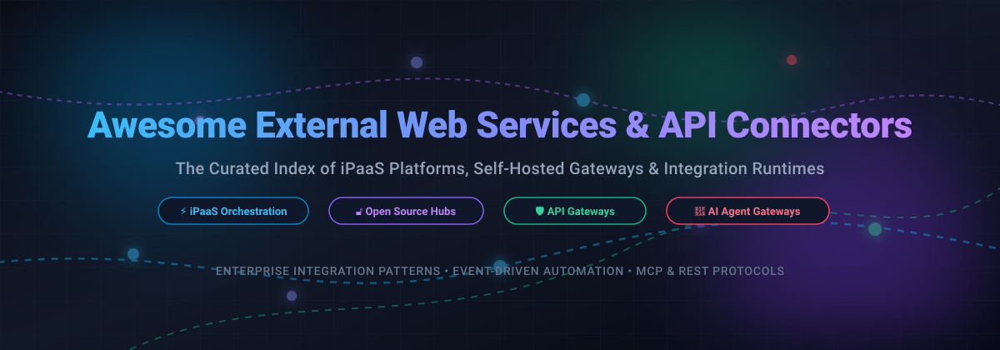

  

# ⚡ Awesome External Web Services & API Connectors 🔌

  
  
  
  
  
  

---

> 🚀 **A curated index of premier SaaS platforms, self-hosted integration runtimes, open-source API gateways, and community-driven connector hubs for building, automating, and governing external web service workflows and AI agents.**

**Keywords:** `api connectors`, `ipaas`, `workflow automation`, `enterprise integration patterns`, `web services`, `api gateway`, `mcp connectors`, `data integration`, `microservices middleware`, `ai agent tools`

---

## 📑 Table of Contents
- [🌐 Sector Overview & Market Dynamics](#-sector-overview--market-dynamics)
- [💼 SaaS/Hosted Platforms](#-saashosted-platforms)
- [🔓 Open-Source GitHub Projects](#-open-source-github-projects)
- [🤝 How to Contribute](#-how-to-contribute)
- [💖 Support & Sponsorship](#-support--sponsorship)
- [📈 Star History](#-star-history)
- [⚠️ Disclaimer](#-disclaimer)

---

## 🌐 Sector Overview & Market Dynamics

The global **Integration Platform as a Service (iPaaS)** and external API connector market is estimated at **$13 billion to $16 billion in 2025–2026**, on a steep growth trajectory expected to surpass **$30+ billion by 2030** (growing at a 20–30% CAGR). 

Structurally, the sector exhibits **moderate-to-high fragmentation** rather than a winner-take-all monopoly: while legacy enterprise leaders (such as MuleSoft/Salesforce and Boomi) command large enterprise contract commitments, rapid fragmentation is continuously fueled by the proliferation of specialized cloud APIs, low-code/no-code workflow platforms (Make, Zapier), Git-native developer suites, and the emerging wave of AI agent toolchains (MCP gateways and event-driven runtime connectors).

---

## 💼 SaaS/Hosted Platforms

| Product | Company Size (Valuation / Revenue) | Starting Pricing | Free Tier / Trial Limits | Description |
|:---|:---|:---|:---|:---|
| **[Make](https://www.make.com/)** | $11B parent (Celonis) / ~$100M ARR target (Est. $53M+ rev) | $9/month (Core tier billed annually) | Free forever: 1,000 credits/mo, up to 2 active scenarios, 15-min interval limit | 🔄 Visual automation platform with credit-based execution, full-text log search, and real-time execution monitoring across 1,500+ apps. |
| **[MuleSoft Anypoint Platform](https://www.mulesoft.com/)** | $6.5B acquisition valuation (Salesforce) / $1B+ ARR | $2,000/month ($24,000/year base commit) | 30-day free trial: full platform access, limited to ~0.1 vCore sandbox runtime and 30-day log/metric retention | 🏛️ Enterprise integration runtime and API management suite with vCore and Mule Credit execution models for mission-critical enterprise workloads. |
| **[Workato](https://www.workato.com/)** | $5.7B valuation / ~$150M ARR | $75/month (Pro self-service, 2,500 credits/mo) | Free forever: 50,000 one-time starter credits with no expiration; Enterprise trial: sales-guided sandbox | ⚡ Enterprise automation and integration platform featuring recipe-based workflows, Connector SDK, and AI agent copilot orchestration. |
| **[Postman](https://www.postman.com/)** | $5.6B valuation / ~$313M ARR | $14/user/month (Basic billed annually) or $9/month (Solo) | Free forever: 1 user, up to 3 shared collection runs, unlimited local runs, no team workspace access | 📮 API development, mocking, testing, and lifecycle management environment standard with Postman CLI and cloud runners. |
| **[Zapier](https://zapier.com/)** | $5.0B valuation / ~$310M ARR | $19.99/month (Professional, billed annually) | Free forever: 100 tasks/month, 2-step Zaps only; 14-day Pro trial: 1,000 tasks with multi-step Zaps | 🔗 No-code workflow automation connector connecting 7,000+ business applications with Webhooks, branching, and automated logic. |
| **[Boomi](https://www.boomi.com/)** | $4.0B acquisition valuation (Francisco Partners & TPG) / >$500M ARR | $99/month + usage (Pay-As-You-Go) | 30-day free trial: full platform access, restricted to 3 standard connectors and sandbox deployment | ☁️ Cloud-native enterprise iPaaS with distributed Atom runtime architecture, data mapping, master data hub, and API gateway management. |
| **[Rapid](https://rapidapi.com/)** (formerly RapidAPI) | $1.0B peak valuation (acquired by Nokia) / ~$24M ARR | $10/month (Team plan per additional user; marketplace APIs start $10/mo Pro) | Free forever: 5 free team seats; Public marketplace: basic plan up to 500k requests/mo / 1k req/hr (capped at 10GB bandwidth/mo) | 🌐 API marketplace and enterprise developer hub for discovering, subscribing to, securing, and testing public and internal APIs. |
| **[Tray.io (Tray.ai)](https://tray.ai/)** | $600M+ valuation / ~$71M ARR | $500/month (Base Pro plan) | 14-day free trial (Tray Academy & evaluation sandbox upon request); no permanent free tier | 🤖 Low-code enterprise iPaaS and workflow automation platform featuring Merlin AI agent builder and 700+ enterprise connectors. |
| **[Celigo](https://www.celigo.com/)** | Private (~$30M-$72M funded) / ~$95M ARR | $600/month (~$7,200/year Standard base tier) | Free forever: 1 active production flow, 2 endpoints, no SSO; 30-day full platform trial | 🏢 iPaaS specialized in ERP, NetSuite, CRM, and eCommerce integrations with pre-built smart business integration apps. |

---

## 🔓 Open-Source GitHub Projects

*Curated list of self-hosted integration runtimes, community connector gateways, high-throughput API gateways, and developer API tools. Sorted in descending order by GitHub_Stars.*

| Project | GitHub_Stars | Description | Primary Languages & Ecosystem |
|:---|:---|:---|:---|
| **[n8n](https://github.com/n8n-io/n8n)** |  | 🌟 **Fair-code visual workflow automation platform with 400+ native connectors.** Community edition is free forever and self-hostable with Docker or npm. Includes rich visual node designer, webhooks, sub-workflows, and built-in AI agent tools. | TypeScript / Node.js |
| **[Hoppscotch](https://github.com/hoppscotch/hoppscotch)** |  | ⚡ **Open-source, lightweight API development ecosystem and client.** Self-host on your own infrastructure with team workspaces, real-time WebSocket/SSE/MQTT/GraphQL support, and keyboard-first UI without cloud dependency. | TypeScript / Vue.js |
| **[Bruno](https://github.com/usebruno/bruno)** |  | 📁 **Fast, Git-friendly, offline-first API client.** Saves API collections directly in your repo as plain text Bru/YAML markup files. No account required, completely local, zero vendor lock-in. | JavaScript / Node.js |
| **[Kong](https://github.com/Kong/kong)** |  | 🦍 **The cloud-native API Gateway & Service Control Platform.** High-performance gateway routing and managing API traffic across hybrid and multi-cloud architectures with extensive plugin marketplace (auth, rate limiting, logging). | Lua / C / OpenResty |
| **[Directus](https://github.com/directus/directus)** |  | 🗄️ **Instant REST & GraphQL API data engine and backend toolkit.** Wraps SQL databases with fully dynamic, configurable API endpoints, webhooks, flows, and an intuitive data studio dashboard. | TypeScript / Node.js |
| **[Hasura GraphQL Engine](https://github.com/hasura/graphql-engine)** |  | ⚡ **Blazing-fast instant GraphQL and REST APIs over new or existing databases.** Features built-in role-based authorization, database event triggers, remote schema federation, and microservice actions. | Haskell / Go |
| **[Dapr](https://github.com/dapr/dapr)** |  | 🎯 **Distributed Application Runtime (CNCF).** Provides event-driven building blocks via HTTP/gRPC sidecars for service-to-service invocation, pub/sub messaging, state management, and external service bindings. | Go |
| **[Activepieces](https://github.com/activepieces/activepieces)** |  | 🧩 **Open-source, no-code workflow automation platform (Zapier/Make alternative).** Features 200+ modular piece connectors, MIT-licensed core, visual canvas, and self-hosted execution. | TypeScript / Node.js |
| **[Airbyte](https://github.com/airbytehq/airbyte)** |  | 🚀 **Open-source data integration engine with 350+ pre-built connectors.** Syncs data seamlessly from third-party SaaS APIs and databases to warehouses, lakes, and vectors for analytics and AI pipelines. | Java / Python |
| **[Apache Camel](https://github.com/apache/camel)** |  | 🐫 **The foundational open-source integration framework and Enterprise Integration Patterns (EIP) standard.** Features 300+ components covering databases, messaging (Kafka, JMS), cloud providers, and SaaS apps. | Java / Spring Boot / Quarkus |
| **[OpenConnector](https://github.com/oomol-lab/open-connector)** |  | 🤖 **Open-source connector gateway purpose-built for AI agents.** Offers 1,000+ providers and 10,000+ pre-built Actions with MCP support, token credential protection, and fine-grained runtime action governance policies. | TypeScript / Node.js / Docker |
| **[KrakenD](https://github.com/krakend/krakend-ce)** |  | ⚡ **Ultra-high-performance, stateless API Gateway.** Handles +70k reqs/s on a single node under 50MB memory. Provides response transformation, aggregation, OAuth validation, and rate limiting with zero database dependencies. | Go |
| **[Spring Integration](https://github.com/spring-projects/spring-integration)** |  | 🍃 **Enterprise Integration Patterns natively built into the Spring ecosystem.** Extends Spring Boot with lightweight asynchronous messaging channels, adapters, filters, and transformers. | Java / Spring |

---

## 🤝 How to Contribute

Contributions are warmly encouraged! To propose updates or add new SaaS platforms or open-source connectors:

1. 🍴 **Fork** the repository.
2. 🌿 Create a new feature branch (`git checkout -b feature/new-connector`).
3. 📝 Update `README.md` following the existing format (include name, company size/stars, starting pricing/limits, and description).
4. 🚀 Commit your changes (`git commit -m "Add NewConnector"`) and push to your branch.
5. 📬 Open a **Pull Request** detailing your additions.

---

## 💖 Support & Sponsorship

Thank you for visiting and supporting the **Awesome External Web Services & API Connectors** repository! 🙌

If you find this directory valuable for your engineering team, architecture design, or integration workflows, please consider:
- ⭐ **Starring** the repository on GitHub
- 🍴 **Forking** and contributing additional connectors
- 📢 **Sharing** this repository with fellow developers and DevOps engineers
- ☕ **Buying a coffee & sponsoring ongoing maintenance:** [Sponsor Dashboard on GitHub Sponsors](https://github.com/sponsors/ishandutta2007)

---

## 📈 Star History

---

## ⚠️ Disclaimer

- This list is community-curated for informational and architectural guidance; inclusion does not constitute endorsement.
- Connecting external web services and APIs involves sensitive authentication tokens, OAuth secrets, and business data. Always adhere to least-privilege API permissions, automated credential rotation, and strict network egress filtering.
- Review and evaluate self-hosted open-source runtimes versus managed enterprise SaaS based on your team's maintenance capacity, compliance requirements, and latency targets.

---

  <b>Built with ❤️ for integration architects, platform engineers, and AI developers.</b> 
  Let's build reliable, governed, and developer-friendly web connectivity together.

